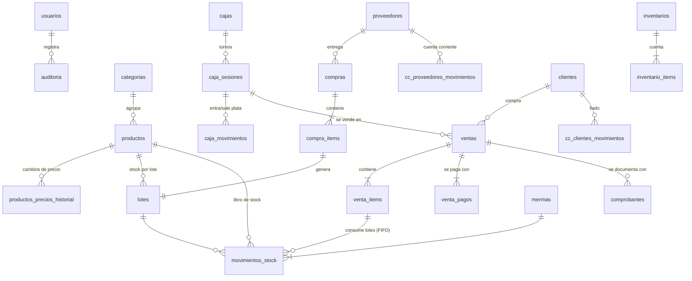

# Pescadería — Diseño técnico

SQL completo: [`server/src/db/sql/001_esquema_inicial.sql`](../server/src/db/sql/001_esquema_inicial.sql), aplicado por la primera migración de Knex. Las migraciones siguientes van en `server/src/db/migraciones/`.

---

## 1. Modelo de datos

### Diagrama (resumido)



### Tablas por módulo

| Módulo | Tablas | Para qué |
|---|---|---|
| Seguridad | `usuarios`, `sesiones`, `auditoria`, `configuracion` | Login, roles DUENO/CAJERO, PIN de autorización, registro inmutable de acciones sensibles, parámetros del negocio |
| Catálogo | `categorias`, `productos`, `productos_precios_historial` | Productos por kg o unidad, precio de venta, último costo, stock mínimo, favoritos |
| Compras | `proveedores`, `compras`, `compra_items`, `lotes` | Ingreso de mercadería por remito o factura. Cada ítem crea un **lote** con costo y vencimiento |
| Stock | `movimientos_stock`, `mermas`, `inventarios`, `inventario_items` | Libro de todo cambio de stock, desperdicio con motivo y conteo físico |
| Caja | `cajas`, `caja_sesiones`, `caja_movimientos`, `categorias_gasto` | Turnos, arqueo y todo ingreso y egreso por medio de pago |
| Ventas | `ventas`, `venta_items`, `venta_pagos` | La operación comercial: qué se vendió, a qué precio, con qué costo real y cómo se pagó |
| Comprobantes | `comprobantes`, `numeradores` | El papel que documenta la venta (hoy ticket interno) |
| Cuentas corrientes | `cc_clientes_movimientos`, `cc_proveedores_movimientos` | Fiado de clientes y deuda con proveedores |
| Vistas | `v_stock_productos`, `v_saldos_clientes`, `v_saldos_proveedores` | Stock con alertas y valor, y saldos |

### Decisiones importantes

1. **Libros contables "de solo inserción".** `movimientos_stock`, `caja_movimientos`, las dos cuentas corrientes y `auditoria` tienen un trigger que **impide UPDATE y DELETE**. Nada se corrige borrando: se corrige con un movimiento inverso, como en contabilidad. Así es imposible "dibujar" la caja o el stock sin dejar rastro.
2. **Stock por lotes con FIFO y costo real.** Una venta de 3 kg puede consumir 1 kg del lote viejo a $6.000 y 2 kg del nuevo a $6.500. Se generan dos filas en `movimientos_stock`, y `venta_items.costo_total` guarda el costo **real**. Así el margen por producto sale exacto, no estimado.
3. **Stock negativo permitido, pero controlado.** Si se vende más de lo registrado, la parte sin lote se registra con `lote_id = NULL`, valorizada al `costo_referencia`. La venta no se frena y queda marcada para revisar. Invariante: `SUM(lotes.cantidad_actual) = GREATEST(productos.stock_actual, 0)`. El próximo ingreso primero "tapa" el faltante.
4. **`productos.stock_actual` es una caché.** Se actualiza en la misma transacción que los lotes, con `SELECT … FOR UPDATE` sobre la fila del producto. Eso ordena las ventas simultáneas del mismo producto y evita carreras. Invariante verificable: `stock_actual = SUM(movimientos_stock.cantidad)`. Va a haber un test y un chequeo de consistencia para el dueño.
5. **Venta y comprobante desacoplados.** `ventas` no tiene número de ticket ni nada fiscal. `comprobantes` tiene `tipo`, `punto_venta`, `numero` correlativo sin huecos (vía `numeradores` con bloqueo), `leyenda` ("Comprobante no válido como factura") y `datos_fiscales JSONB` reservado. Para facturar a futuro: se agrega el tipo `FACTURA_B` al CHECK, un servicio que pide el CAE a ARCA y guarda el resultado en `datos_fiscales`. Ventas no se toca.
6. **Fotos de datos.** `venta_items` guarda `descripcion` y `precio_unitario` del momento. Si mañana cambia el precio o el nombre, la venta histórica no cambia.
7. **Descuento global prorrateado.** Se reparte entre los ítems (`descuento_prorrateado`) para que el margen por producto sea real.
8. **El signo y la coherencia los controla la base,** no solo el código. Por ejemplo: un `GASTO` siempre es negativo, una venta anulada exige motivo, `total = subtotal - descuentos`, solo puede haber una caja abierta por puesto y un solo inventario abierto, no se puede cargar dos veces el mismo remito del mismo proveedor, y la venta por unidad no admite decimales.
9. **Importes con 2 decimales y costos unitarios con 4.** El costo por kg sale de dividir el total del remito por los kg, y con 2 decimales se pierden centavos al volver a multiplicar.
10. **Sin borrado físico** de productos, clientes y proveedores (`activo = false`), porque tienen historia asociada.

### Cómo se registran las operaciones (todas en una transacción)

| Operación | Escribe en |
|---|---|
| **Ingreso de mercadería** | `compras` + `compra_items` + `lotes` + `movimientos_stock(COMPRA)` + `productos` (stock y costo de referencia) + `cc_proveedores_movimientos(COMPRA)`. Si es contado: también `PAGO` y, si es en efectivo, `caja_movimientos(PAGO_PROVEEDOR)` |
| **Venta** | `ventas` + `venta_items` + consumo FIFO en `lotes` + `movimientos_stock(VENTA)` por lote + `productos.stock_actual` + `venta_pagos` + `caja_movimientos(VENTA)` por cada medio que no sea fiado + `cc_clientes_movimientos(VENTA)` si hay fiado + `numeradores` + `comprobantes` |
| **Anulación de venta** (PIN) | `ventas.estado` + devolución a los **mismos lotes** + `movimientos_stock(ANULACION_VENTA)` + `caja_movimientos(ANULACION_VENTA)` en la caja abierta actual + `cc_clientes(ANULACION_VENTA)` + `comprobantes.estado` + `auditoria` |
| **Merma** | `mermas` + consumo FIFO + `movimientos_stock(MERMA)` |
| **Ajuste manual** (dueño) | `movimientos_stock(AJUSTE, motivo)` + lote de origen `AJUSTE` si suma + `auditoria` |
| **Cierre de inventario** | Por cada diferencia: `movimientos_stock(INVENTARIO)` + `auditoria` |
| **Cierre de caja** | `caja_sesiones`: esperado, contado, diferencia, totales por medio y detalle de billetes + `auditoria` |
| **Cobro de fiado** | `caja_movimientos(COBRO_CLIENTE)` + `cc_clientes_movimientos(PAGO)` |

---

## 2. Estructura del proyecto

Un solo repositorio con dos paquetes (npm workspaces) y un paquete `shared` con los esquemas Zod, que valida igual en el frontend y en el backend.

```
pescaderia/
├── package.json                  # workspaces: server, client, shared
├── docker-compose.yml            # dev: postgres + postgres de test
├── docker-compose.prod.yml       # prod: app + postgres + backup
├── .env.example
├── docs/
│   ├── DISENO.md
│   └── DEPLOY.md                 # (Fase 4)
├── shared/
│   └── src/
│       ├── schemas/              # Zod: producto, venta, compra, caja, ...
│       └── constants.js          # roles, medios de pago, motivos de merma
├── server/
│   ├── knexfile.js
│   ├── migrations/               # 001_base.js, 002_catalogo.js, ...
│   ├── seeds/                    # 01_usuarios.js, 02_categorias.js, 03_demo.js
│   ├── src/
│   │   ├── app.js                # arma Express (middlewares + rutas)
│   │   ├── server.js             # levanta el puerto
│   │   ├── config/               # env (validado con Zod), db (knex + TZ), logger (pino)
│   │   ├── middlewares/
│   │   │   ├── auth.js           # requiereSesion, requierePermiso('ventas.anular')
│   │   │   ├── validar.js        # validar(schema) → req.body ya limpio
│   │   │   ├── errores.js        # manejo centralizado → mensajes claros en español
│   │   │   └── rateLimit.js      # login y PIN
│   │   ├── lib/
│   │   │   ├── dinero.js         # decimal.js: sumar, multiplicar, redondear, prorratear
│   │   │   ├── errores.js        # ErrorNegocio, ErrorNoEncontrado, ErrorPermiso
│   │   │   ├── permisos.js       # mapa rol → permisos
│   │   │   └── fechas.js         # inicio/fin de día en America/Argentina/Cordoba
│   │   ├── modules/
│   │   │   ├── auth/             # routes, controller, service, repository
│   │   │   ├── usuarios/
│   │   │   ├── productos/
│   │   │   ├── proveedores/
│   │   │   ├── compras/
│   │   │   ├── stock/            # stock.service: consumirFIFO, ingresarLote, mermas, ajustes
│   │   │   ├── inventarios/
│   │   │   ├── ventas/
│   │   │   ├── comprobantes/     # emisor de ticket interno (a futuro, otros emisores)
│   │   │   ├── caja/
│   │   │   ├── clientes/
│   │   │   ├── reportes/         # consultas + exportar a Excel (exceljs) / PDF (pdfkit)
│   │   │   ├── auditoria/
│   │   │   └── configuracion/
│   │   └── routes.js             # monta /api/<modulo>
│   └── test/
│       ├── setup.js              # migra la base de test y la limpia entre tests
│       ├── stock.fifo.test.js
│       ├── ventas.test.js
│       ├── ventas.anulacion.test.js
│       ├── caja.test.js
│       └── compras.test.js
└── client/
    ├── vite.config.js
    ├── index.html
    └── src/
        ├── main.jsx, App.jsx, router.jsx
        ├── api/                  # cliente fetch + funciones por módulo
        ├── hooks/                # useSesion, useCajaAbierta, ... (TanStack Query)
        ├── components/           # BotonGrande, TecladoNumerico, Confirmar, PedirPin, Tabla, ...
        ├── features/
        │   ├── pos/              # pantalla de venta: grilla, búsqueda, carrito, cobro
        │   ├── ticket/           # vista imprimible 58/80 mm
        │   ├── productos/        # lista + edición rápida de precios
        │   ├── compras/          # ingreso de mercadería
        │   ├── stock/            # stock, mermas, ajustes, inventario, alertas
        │   ├── caja/             # abrir, egresos, cerrar/arqueo
        │   ├── clientes/  proveedores/  reportes/  dashboard/  usuarios/  configuracion/
        └── utils/                # formatear $ y kg en es-AR
```

**Capas dentro de cada módulo:**
`routes` (URL + permiso + validación) → `controller` (HTTP: lee req, responde) → `service` (reglas de negocio, abre la transacción) → `repository` (SQL con Knex, recibe `trx`).
Los services pueden llamarse entre sí pasando la misma `trx`. Por ejemplo, `ventas.service` usa `stock.service.consumirFIFO(trx, …)`, `caja.service.registrarMovimiento(trx, …)` y `comprobantes.service.emitir(trx, …)`. Así toda la venta es atómica.

**Librerías:** express 5, knex, pg, express-session (store propio sobre Knex, tabla `sesiones`), bcryptjs, zod, decimal.js, helmet, express-rate-limit, pino. Fase 3: exceljs y pdfkit. En el frontend: react, react-router, @tanstack/react-query, tailwindcss. Para tests: vitest y supertest.

---

## 3. Permisos

| Permiso | Dueño | Cajero |
|---|:-:|:-:|
| Vender, cobrar, imprimir ticket | ✅ | ✅ |
| Descuento hasta el % configurado (`descuento_max_cajero`) | ✅ | ✅ |
| Descuento mayor / anular venta | ✅ | 🔑 PIN del dueño |
| Ingresar mercadería | ✅ | ✅ (sin ver costos de otros ingresos) |
| Registrar merma | ✅ | ✅ |
| Ajuste manual de stock, cerrar inventario | ✅ | ❌ |
| Contar en inventario | ✅ | ✅ |
| Abrir caja, egresos, cerrar caja | ✅ | ✅ |
| Retiro de efectivo | ✅ | 🔑 PIN |
| Ver costos, márgenes, reportes, dashboard | ✅ | ❌ |
| Editar precios, productos, proveedores, usuarios, configuración | ✅ | ❌ |
| Fiado (vender a cuenta corriente) y cobrar fiado | ✅ | ✅ (respetando el límite de crédito; si lo supera, 🔑 PIN) |
| Pagar a proveedor | ✅ | ❌ |

🔑 = el cajero hace la operación y el dueño pone su PIN en el momento. En la auditoría queda quién la hizo y quién la autorizó.

---

## 4. Endpoints (API REST, prefijo `/api`, JSON)

Convenciones: sesión por cookie. Errores con formato `{ error: { codigo, mensaje, campos? } }` y mensaje pensado para mostrarse tal cual. Listados con `?q=&pagina=&porPagina=`. Fechas de reportes con `?desde=YYYY-MM-DD&hasta=YYYY-MM-DD` en hora de Córdoba.
**D** = solo dueño · **🔑** = acepta `pinAutorizacion` en el body · **Fase** = cuándo se implementa.

### Auth y usuarios
| Método | Ruta | Descripción | Permiso | Fase |
|---|---|---|---|---|
| POST | `/auth/login` | Iniciar sesión | público (rate limit) | 0 |
| POST | `/auth/logout` | Cerrar sesión | sesión | 0 |
| GET | `/auth/yo` | Usuario actual, permisos y caja abierta | sesión | 0 |
| POST | `/auth/verificar-pin` | Valida el PIN de un dueño (las acciones protegidas reciben `pinAutorizacion` en el body; 5 errores → 10 min de bloqueo) | sesión (rate limit) | 0 |
| PUT | `/auth/mi-password` · `/auth/mi-pin` | Cambiar contraseña / PIN propio | sesión | 0 |
| GET/POST | `/usuarios` | Listar / crear | D | 0 |
| PUT | `/usuarios/:id` | Editar, cambiar rol, desactivar | D | 0 |
| POST | `/usuarios/:id/reset-password` | Blanquear contraseña | D | 0 |

### Configuración y auditoría
| Método | Ruta | Descripción | Permiso | Fase |
|---|---|---|---|---|
| GET | `/configuracion` | Datos del negocio y parámetros | sesión | 1 |
| PUT | `/configuracion` | Editar | D | 1 |
| GET | `/auditoria` | Filtros: usuario, acción, entidad, fechas | D | 2 |

### Catálogo
| Método | Ruta | Descripción | Permiso | Fase |
|---|---|---|---|---|
| GET | `/categorias` · POST · PUT `/:id` | Categorías | GET sesión / resto D | 1 |
| GET | `/productos` | Listado. `?q=&categoriaId=&activo=` (al cajero no le llegan costos) | sesión | 1 |
| GET | `/productos/pos` | Datos livianos para el POS: activos, favoritos y más vendidos, con precio y stock | sesión | 1 |
| GET | `/productos/:id` | Detalle con lotes vigentes | sesión | 1 |
| POST | `/productos` · PUT `/:id` | Crear / editar | D | 1 |
| PATCH | `/productos/:id/precio` | Cambio rápido de precio (deja historial) | D | 1 |
| PATCH | `/productos/precios` | Cambio de precios masivo: lista `[{id, precio}]`, o `{categoriaId, porcentaje}` | D | 1 |
| PATCH | `/productos/:id/favorito` | Marcar / desmarcar favorito | D | 1 |
| GET | `/productos/:id/historial-precios` | Venta y compra | D | 2 |

### Proveedores y compras
| Método | Ruta | Descripción | Permiso | Fase |
|---|---|---|---|---|
| GET/POST | `/proveedores` · PUT `/:id` | Ficha de proveedor | GET sesión / resto D | 1 |
| GET | `/proveedores/:id/cuenta-corriente` | Movimientos y saldo | D | 2 |
| POST | `/proveedores/:id/pagos` | Registrar pago (efectivo de caja / transferencia / cheque) | D | 2 |
| POST | `/proveedores/:id/notas-credito` | Nota de crédito o devolución | D | 2 |
| GET | `/compras` | Listado. `?proveedorId=&desde=&hasta=` | sesión | 1 |
| GET | `/compras/:id` | Detalle | sesión | 1 |
| POST | `/compras` | **Ingreso de mercadería**: crea lotes, suma stock y genera deuda o pago | sesión | 1 |
| POST | `/compras/:id/anular` | Anula, si los lotes no fueron consumidos | D | 1 |

### Stock
| Método | Ruta | Descripción | Permiso | Fase |
|---|---|---|---|---|
| GET | `/stock` | Stock por producto (vista), `?bajoMinimo=&categoriaId=` | sesión (valor solo D) | 1 |
| GET | `/stock/alertas` | Bajo mínimo y vencimientos próximos (días configurables) | sesión | 2 |
| GET | `/stock/productos/:id/movimientos` | Libro de stock de un producto | D | 2 |
| GET/POST | `/mermas` | Listar / registrar merma con motivo | sesión | 2 |
| POST | `/stock/ajustes` | Ajuste manual `{productoId, cantidadNueva, motivo}` | D | 2 |
| GET | `/stock/consistencia` | Verifica las invariantes (lotes = caché = libro) | D | 2 |
| GET/POST | `/inventarios` | Listar / iniciar (total o por categoría) | GET sesión / POST D | 2 |
| GET | `/inventarios/:id` | Planilla de conteo | sesión | 2 |
| PUT | `/inventarios/:id/items/:productoId` | Cargar cantidad contada | sesión | 2 |
| POST | `/inventarios/:id/cerrar` | Aplica las diferencias como movimientos | D | 2 |
| POST | `/inventarios/:id/cancelar` | Cancela sin aplicar | D | 2 |

### Ventas y comprobantes
| Método | Ruta | Descripción | Permiso | Fase |
|---|---|---|---|---|
| POST | `/ventas` | **Confirmar venta**: ítems, descuentos, pagos y cliente opcional. Devuelve venta y comprobante | sesión + caja abierta (🔑 si el descuento supera el máximo) | 1 |
| GET | `/ventas` | Listado. `?desde=&hasta=&estado=&usuarioId=&cajaSesionId=` | sesión (el cajero ve las de su turno) | 1 |
| GET | `/ventas/:id` | Detalle (costos solo D) | sesión | 1 |
| POST | `/ventas/:id/anular` | `{motivo, pinAutorizacion}` | 🔑 | 1 |
| GET | `/comprobantes/:id` | Datos para imprimir el ticket | sesión | 1 |
| POST | `/comprobantes/:id/reimpresion` | Suma 1 al contador de reimpresiones y devuelve los datos | sesión | 1 |

### Caja
| Método | Ruta | Descripción | Permiso | Fase |
|---|---|---|---|---|
| GET | `/cajas` | Puestos y su estado (abierta / cerrada, quién) | sesión | 1 |
| POST | `/cajas/:id/abrir` | `{montoInicial}` | sesión | 1 |
| GET | `/caja-sesiones/actual` | Turno abierto del puesto, con totales en vivo por medio | sesión | 1 |
| GET | `/caja-sesiones` · `/:id` | Historial de turnos y detalle | D | 1 |
| POST | `/caja-sesiones/:id/movimientos` | Gasto / retiro / ingreso de cambio | sesión (retiro 🔑) | 1 |
| GET | `/caja-sesiones/:id/resumen-cierre` | Lo que el sistema espera, antes de contar | sesión | 1 |
| POST | `/caja-sesiones/:id/cerrar` | `{efectivoContado, detalleArqueo?, observaciones}` | sesión | 1 |
| GET | `/categorias-gasto` · POST · PUT `/:id` | Rubros de gasto | GET sesión / resto D | 1 |

### Clientes (fiado)
| Método | Ruta | Descripción | Permiso | Fase |
|---|---|---|---|---|
| GET/POST | `/clientes` · PUT `/:id` | Ficha (búsqueda rápida `?q=`) | sesión / editar D | 3 |
| GET | `/clientes/:id/cuenta-corriente` | Movimientos y saldo | sesión | 3 |
| POST | `/clientes/:id/pagos` | Cobro de fiado (entra a la caja abierta) | sesión + caja abierta | 3 |
| GET | `/clientes/deudores` | Clientes con saldo > 0 | D | 3 |

### Reportes y dashboard (todos D; `?formato=xlsx|pdf` para exportar)
| Método | Ruta | Descripción | Fase |
|---|---|---|---|
| GET | `/dashboard` | Hoy: ventas, ticket promedio, ganancia, caja, alertas, top 5 | 3 |
| GET | `/reportes/ventas` | Por día / producto / categoría / medio de pago (`?agrupar=`) | 3 |
| GET | `/reportes/margenes` | Ganancia y margen por producto y categoría (costo FIFO real) | 3 |
| GET | `/reportes/mas-vendidos` | Ranking por kg, unidades o $ | 3 |
| GET | `/reportes/mermas` | Por motivo y producto, en kg y $ | 3 |
| GET | `/reportes/stock-valorizado` | A costo y a precio de venta | 3 |
| GET | `/reportes/deudas-proveedores` | Saldos y antigüedad | 3 |
| GET | `/reportes/cajas` | Turnos con diferencias | 3 |
| GET | `/reportes/compras` | Por proveedor y producto, con evolución de precio de compra | 3 |

### Sistema
| Método | Ruta | Descripción |
|---|---|---|
| GET | `/salud` | Healthcheck (app y base) para Docker y monitoreo |
